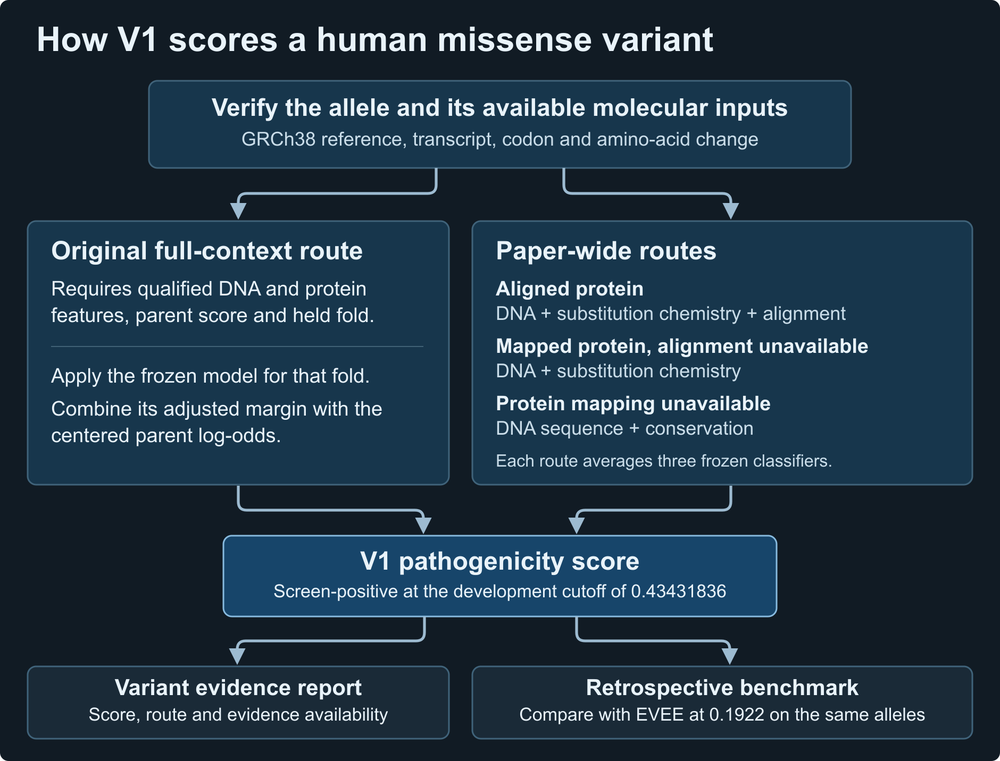

# Standalone human missense predictor · V1

On 161,579 paper variants outside historical training and development, the standalone predictor caught 222 more pathogenic or likely pathogenic variants than EVEE and flagged 9,620 more benign or likely benign variants. EVEE had stronger overall discrimination. These results describe a retrospective comparison of frozen scores.

## Architecture and design

1. **Resolve the allele.** Align the genomic change to the reference sequence, transcript, codon and amino-acid substitution. An alternative isoform can have a different consequence. Reports identify the transcript and whether it matches the paper.
2. **Score the clinical endpoint.** The original full-context route uses DNA and protein sequence representations with molecular context where its inputs are qualified. The paper-wide route uses three frozen gradient-boosted classifiers per input type. The protein-inclusive heads combine DNA sequence and conservation with substitution chemistry and vertebrate protein alignments. A parallel DNA-only ensemble covers missing protein mappings. EVEE is a comparator. No clinical lookup or assay result enters a new variant's score.
3. **Report molecular effects separately.** For supported proteins, the pipeline reports predictions for specific readouts, including reporter abundance and G6PD-dependent yeast growth. Each output carries its unit and scope. An exploratory alternative-transcript score remains separate from the clinical call.

## Clinical benchmark against EVEE

The paper roster has 198,876 variants. The primary comparison used 44,644 pathogenic or likely pathogenic and 116,935 benign or likely benign alleles outside historical TRAIN/DEV. The standalone cutoff (0.43431836, rounded here) was selected on 8,048 historical DEV variants to match EVEE's sensitivity at its project cutoff of 0.1922. Historical investigations had already examined much of this archive.

| Outside-development measure | Standalone | EVEE |
|---|---:|---:|
| Pathogenic variants missed | **2,689** | 2,911 |
| Sensitivity | **93.98%** | 93.48% |
| Benign variants flagged | 22,372 | **12,752** |
| Specificity | 80.87% | **89.09%** |
| AUROC | 0.9465 | **0.9708** |

The sensitivity difference was +0.50 percentage points (95% interval +0.02 to +0.95, resampling genes with the thresholds fixed). The standalone predictor rescued 1,776 pathogenic variants missed by EVEE and missed 1,554 that EVEE caught. [Aggregate counts](benchmarks/missense.json) · [EVEE archive](https://doi.org/10.5281/zenodo.19701997)

**Protein evidence helped on matched alleles.** On 146,123 outside-development alleles with qualified alignments, our DNA-only head missed 4,935 pathogenic variants. Adding protein evidence reduced misses to 2,331 and benign flags from 27,223 to 20,691. EVEE missed 2,775 and flagged 11,962 on the same alleles. Among the 9,875 newly recovered protein mappings, 9,842 involved another transcript. Replacing the original calls with those scores would add 54 net pathogenic misses across the fallback cohort, so the clinical default retains its original calls.

**Same-residue check.** Among 251 retrospective pairs with opposing clinical labels at the same residue, sequence alone ranked 211 correctly, sequence plus the tested reference-structure correction ranked 210, and EVEE ranked 207. The strictly fresh roster yielded zero eligible pairs. The structural correction therefore remains exploratory.
